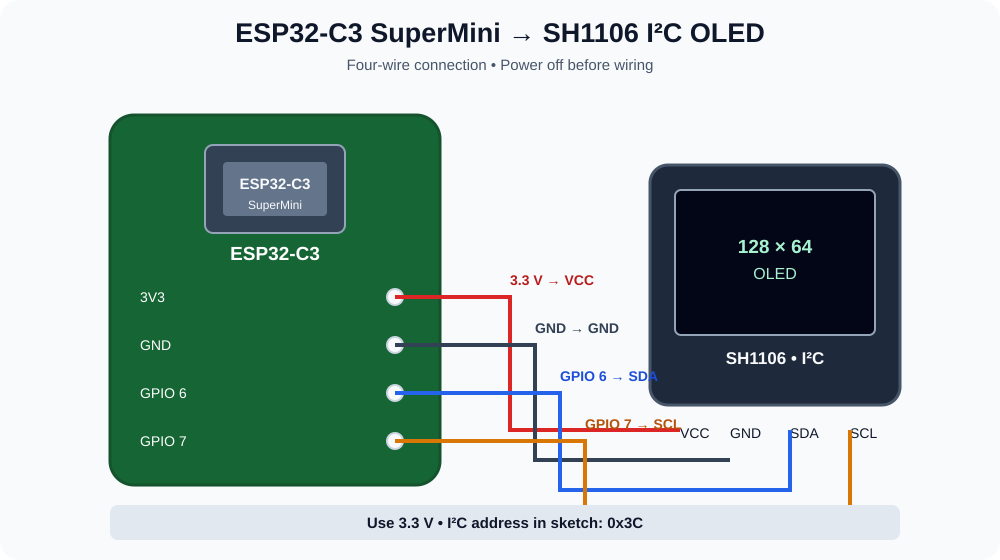

# 🐱 Scuba Cat Keyring — ESP32-C3 + OLED

A tiny animated display project using an **ESP32-C3 SuperMini** and a **128×64 monochrome I²C OLED**. The display plays a looping bitmap animation, making it suitable for a small electronic keyring or desk gadget.

<p align="center">
  
</p>

## ✨ Features

- Plays a frame-by-frame monochrome animation on the OLED.
- Uses an ESP32-C3 SuperMini.
- Uses an SH1106-based 128×64 OLED over I²C.
- Animation data is stored in `video_frames.h`.
- Loops through **54 frames** at approximately **8 frames per second**.

## 🧰 Components

- ESP32-C3 SuperMini development board
- 0.96-inch (or compatible) 128×64 I²C OLED using the SH1106 controller
- Four jumper wires
- USB cable for programming and power

> Check your OLED module's controller and pin labels before wiring. This project uses the Adafruit SH110X library and an I²C address of `0x3C`.

## 🔌 Circuit Diagram & Connections

The SVG diagram above is included in this repository and will display directly on GitHub.

| ESP32-C3 SuperMini | OLED display | Purpose |
|---|---|---|
| `3V3` | `VCC` | 3.3 V power |
| `GND` | `GND` | Ground |
| `GPIO 6` | `SDA` | I²C data |
| `GPIO 7` | `SCL` / `SCK` | I²C clock |

**Important:** Connect the OLED to **3.3 V**, not 5 V. Keep SDA on GPIO 6 and SCL on GPIO 7 to match the sketch.

## 💻 Software Setup

1. Install the [Arduino IDE](https://www.arduino.cc/en/software).
2. Add ESP32 board support in Boards Manager, if it is not already installed.
3. Install these libraries from **Library Manager**:
   - **Adafruit GFX Library**
   - **Adafruit SH110X**
4. Put both project files in the same Arduino sketch folder:
   - `ESP32_C3_OLED_Video.ino`
   - `video_frames.h`
5. Select your ESP32-C3 board and the correct port.
6. Upload the sketch.

## 📁 Repository Structure

```text
Scuba-cat-keyring-using-oled-esp32/
├── ESP32_C3_OLED_Video.ino
├── video_frames.h
├── images/
│   └── esp32-c3-oled-wiring.svg
├── README.md
└── LICENSE
```

## ⚙️ How It Works

- `Wire.begin(6, 7)` configures the I²C bus using GPIO 6 for SDA and GPIO 7 for SCL.
- The display is initialized at I²C address `0x3C`.
- `video_frames.h` contains 54 monochrome, 128×64 bitmap frames stored in program memory.
- The sketch draws each frame and waits 125 ms before drawing the next one, then repeats the animation.

## 🛠️ Troubleshooting

- **OLED stays blank:** Check VCC, GND, SDA, and SCL; confirm that the display uses the SH1106 controller.
- **Display initialization fails:** This sketch expects I²C address `0x3C`. Some modules use `0x3D`; change `OLED_ADDRESS` only if your module requires it.
- **Compilation says `video_frames.h` is missing:** Ensure the header is in the same sketch folder as the `.ino` file and that its filename matches the include statement.
- **Image looks corrupted:** Confirm that the OLED resolution is 128×64 and that the frame data is unchanged.

## 🔐 Power & Safety

Use a stable USB power source while testing. Disconnect power before changing wiring. Avoid shorting the 3.3 V and GND pins.

## 📄 License

This project is released under the MIT License. See [`LICENSE`](LICENSE).

---

Made with an ESP32-C3 and a tiny OLED display. 🐾
